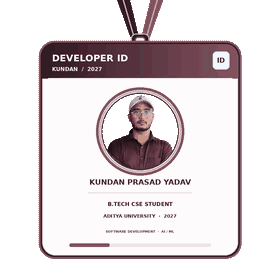

<table width="100%">
<tr>
<td valign="middle" width="72%">
<h1><strong>Kundan Prasad Yadav</strong></h1>

<strong>B.Tech Computer Science and Engineering</strong> Aditya University · Class of 2027

I am a Computer Science and Engineering undergraduate interested in <strong>Software Engineering, Artificial Intelligence (AI), and Machine Learning (ML)</strong>. I enjoy building practical applications and leveraging <strong>AI-driven development</strong> to turn ideas into working solutions. I actively use AI-powered tools for coding, debugging, problem-solving, and improving development workflows, while continuously exploring modern AI technologies and their practical applications.

</td>
<td align="center" valign="middle" width="28%">

</td>
</tr>
</table>

 

