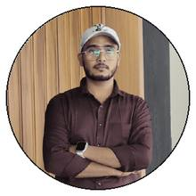

  <!-- Theme-aware monochrome header -->
  
  

   

  <!-- Dark mode keeps the original animated portrait; light mode uses a clear, high-contrast version. -->
  
  

   

  <!-- Name animation adapts to GitHub's selected theme. -->
  
  

   

  B.Tech Computer Science · Class of 2027

   

  <!-- A quiet second animation, kept intentionally understated. -->
  
  

    

  

    

  
  

