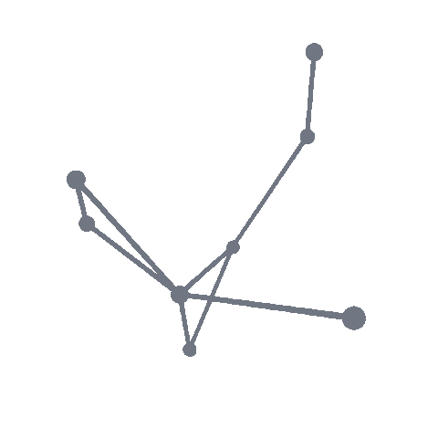

<table>
  <tr>
    <td valign="middle" width="72%">
      <h1><strong>Kundan Prasad Yadav</strong></h1>
      
      
<strong>B.Tech Computer Science and Engineering</strong> Aditya University · Class of 2027

      
Exploring software engineering and AI/ML, strengthening problem-solving skills, and building practical, user-focused applications.

      

        <a href="https://www.linkedin.com/in/kundan-prasad-yadav-954399283">LinkedIn</a> ·
        <a href="https://ydvkundan2005.github.io/Portfolio-/">Portfolio</a> ·
        <a href="https://github.com/ydvkundan2005?tab=repositories">Projects</a>
      

      
<em>Curious by nature. Consistent by practice.</em>

    </td>
    <td align="center" valign="middle" width="28%">
      
    </td>
  </tr>
</table>

 

  

---

## About

I'm a Computer Science and Engineering undergraduate at Aditya University (Class of 2027), with a strong academic foundation in computer science and an interest in software engineering, technology and problem-solving.

My academic exposure includes Data Structures and Algorithms (DSA), Object-Oriented Programming (OOP), DBMS, SQL, Operating Systems, Computer Networks, Software Engineering, Software Testing, Data Mining, Data Warehousing, Compiler Design, Artificial Intelligence (AI), Machine Learning (ML), Natural Language Processing (NLP), and Cloud Computing.

I'm developing technical skills across programming, software development, full-stack development, frontend and backend technologies, REST APIs, database management, data analytics, AI/ML, Generative AI, automation, quality assurance (QA), test automation, debugging, version control (Git/GitHub), CI/CD and DevOps.

Interested in building practical solutions, applying engineering principles, exploring emerging technologies and contributing to real-world projects. Open to internships and entry-level opportunities across Computer Science and Engineering.

## Explore

- [Portfolio](https://ydvkundan2005.github.io/Portfolio-/)
- [LinkedIn](https://www.linkedin.com/in/kundan-prasad-yadav-954399283)
- [GitHub repositories](https://github.com/ydvkundan2005?tab=repositories)

---
